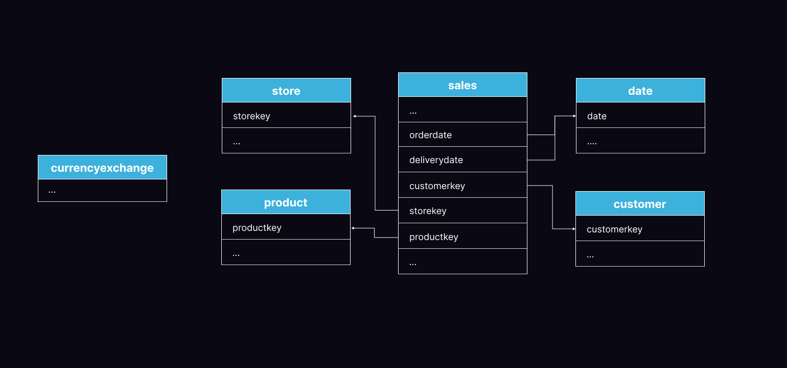
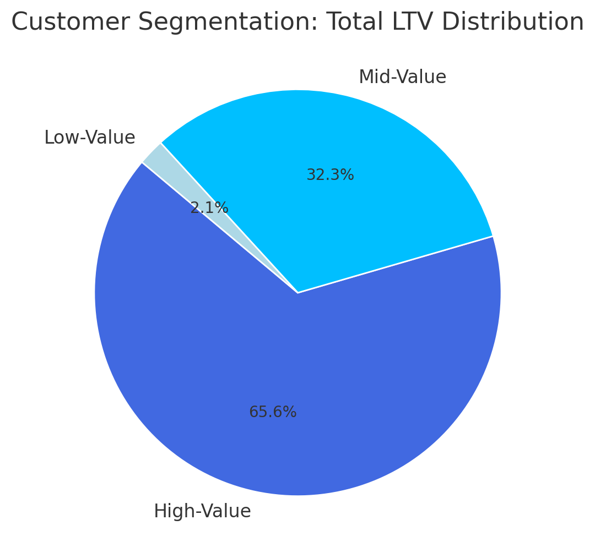
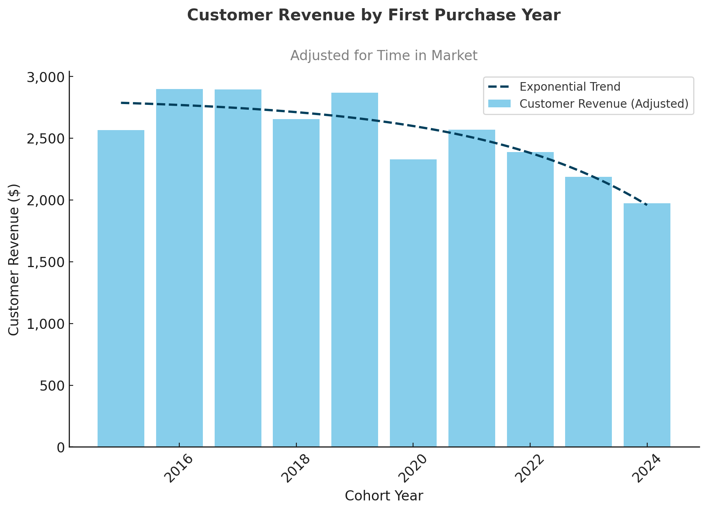
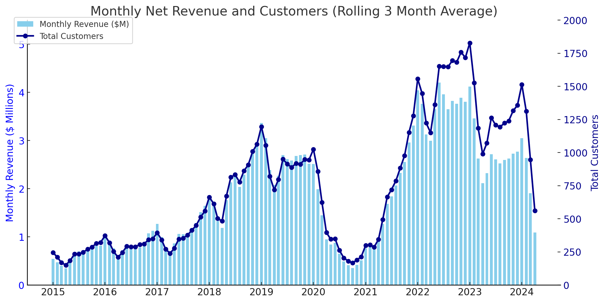
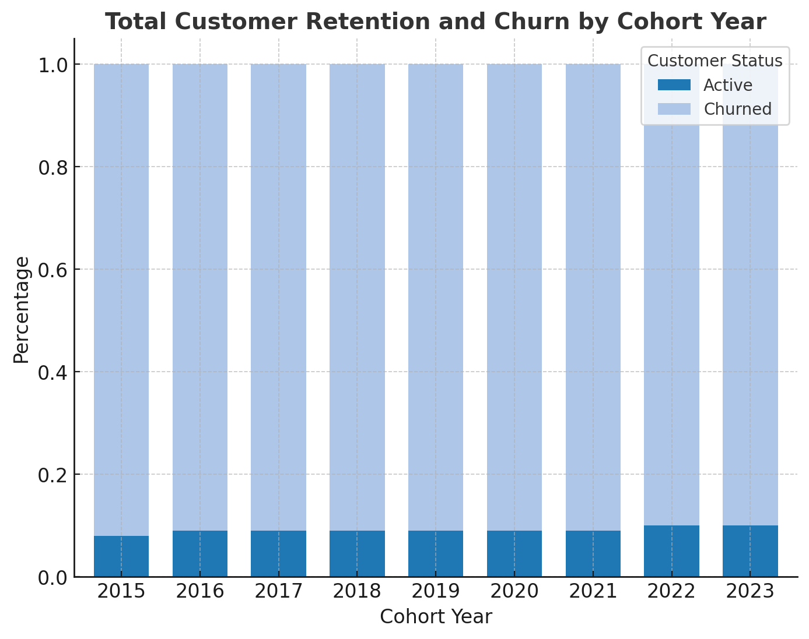

# 📊 Intermediate SQL – Sales Analysis

**Author:** Muhammad Atif – Aspiring Data Engineer / Data Analyst
**GitHub:** [@atifkhan215](https://github.com/atifkhan215)

---

## 📌 Overview

In this project I analyze customer behavior, retention, and lifetime value (LTV) for an e-commerce company (Contoso sales data) using **PostgreSQL**. The goal is to find out which customers bring in the most value, how different customer groups perform over time, and who is at risk of leaving, then turn those findings into recommendations that improve retention and grow revenue.

## ❓ Business Questions

1. **Customer Segmentation:** Who are our most valuable customers?
2. **Cohort Analysis:** How do different customer groups generate revenue?
3. **Retention Analysis:** Which customers haven't purchased recently?

## 🗂️ Dataset & Data Model

The database contains sales transactions, customers, products, stores, and currency exchange tables.

## 📁 Project Structure

| File | Description |
|------|-------------|
| [0_create_view.sql](0_create_view.sql) | Builds the `cohort_analysis` view used by every analysis |
| [1_customer_segmentation.sql](1_customer_segmentation.sql) | Segments customers into Low / Mid / High value by LTV |
| [2_cohort_analysis.sql](2_cohort_analysis.sql) | Revenue and customer trends by cohort year |
| [3_retention_analysis.sql](3_retention_analysis.sql) | Active vs. churned customers by cohort |
| [images/](images/) | Charts used in this README |

---

## 🧹 Data Preparation

**🖥️ Query:** [0_create_view.sql](0_create_view.sql)

- Aggregated sales and customer data into revenue metrics (net revenue = quantity × net price × exchange rate)
- Calculated each customer's first purchase date and cohort year with window functions
- Cleaned customer names (`TRIM` + `CONCAT`)
- Saved everything as a reusable **view** (`cohort_analysis`)

---

## 🔍 Analysis

### 1️⃣ Customer Segmentation

**🖥️ Query:** [1_customer_segmentation.sql](1_customer_segmentation.sql)

- Calculated total lifetime value (LTV) for every customer
- Used `PERCENTILE_CONT` to find the 25th and 75th percentile cut-offs
- Assigned customers to **Low**, **Mid**, and **High-value** segments
- Calculated total revenue, revenue share, and average LTV per segment

**📈 Visualization:**

**📊 Key Findings:**
- **High-value** segment (25% of customers) drives **66%** of revenue (**$135.4M**)
- **Mid-value** segment (50% of customers) generates **32%** of revenue (**$66.6M**)
- **Low-value** segment (25% of customers) accounts for only **2%** of revenue (**$4.3M**)

**💡 Business Insights:**
- **High-Value (66% revenue):** Offer a premium membership program to the 12,372 VIP customers – losing even one of them has a big impact on revenue.
- **Mid-Value (32% revenue):** Create upgrade paths through personalized promotions – a potential $66.6M → $135.4M revenue opportunity.
- **Low-Value (2% revenue):** Run re-engagement campaigns and price-sensitive promotions to increase purchase frequency.

---

### 2️⃣ Customer Revenue by Cohort

**🖥️ Query:** [2_cohort_analysis.sql](2_cohort_analysis.sql)

- Tracked revenue and customer count per cohort
- Grouped cohorts by year of first purchase
- Compared revenue per customer both raw and adjusted for time in market

**📈 Visualizations:**

*Customer Revenue by Cohort (adjusted for time in market – first purchase only)*

*Monthly Revenue & Customer Trends (3-month rolling average)*

**📊 Key Findings:**
- Revenue per customer is **declining**: older cohorts (2016–2018) spent ~**$2,800+**, while the 2024 cohort dropped to ~**$1,970**.
- Revenue and customer counts **peaked in 2022–2023** and are now trending down in 2024.
- High volatility, with sharp drops in 2020 and 2024, points to retention challenges.

**💡 Business Insights:**
- Target recent cohorts (2022–2024) with personalized offers to prevent churn.
- Introduce loyalty programs or subscriptions to stabilize revenue.
- Apply what worked for high-spending cohorts (2016–2018) to newer customers.

---

### 3️⃣ Customer Retention

**🖥️ Query:** [3_retention_analysis.sql](3_retention_analysis.sql)

- Found each customer's last purchase with `ROW_NUMBER()`
- Labeled customers as **Churned** (no purchase in the last 6 months) or **Active**
- Calculated churn percentage per cohort year

**📈 Visualization:**

**📊 Key Findings:**
- Cohort churn levels off at about **90%** after 2–3 years, a predictable long-term pattern.
- Retention is consistently low (**8–10%**) across all cohorts, so the problem is systemic rather than tied to specific years.
- Newer cohorts (2022–2023) are following the same churn path, so future cohorts will likely do the same without intervention.

**💡 Business Insights:**
- Strengthen engagement in the first 1–2 years with onboarding incentives, loyalty rewards, and personalized offers.
- Focus win-back campaigns on **high-value churned customers** for the best ROI.
- Use customer-level warning signs to step in before at-risk customers lapse.

---

## 🚀 Strategic Recommendations

1. **Customer Value Optimization** (Segmentation)
   - Launch a VIP program for the 12,372 high-value customers (66% of revenue)
   - Build personalized upgrade paths for the mid-value segment ($66.6M → $135.4M opportunity)
   - Design price-sensitive promotions for the low-value segment

2. **Cohort Performance Strategy** (Cohort Analysis)
   - Target 2022–2024 cohorts with personalized re-engagement offers
   - Use loyalty/subscription programs to smooth out revenue swings
   - Apply successful 2016–2018 strategies to newer customers

3. **Retention & Churn Prevention** (Retention)
   - Invest in the first 1–2 years with onboarding incentives and loyalty rewards
   - Run targeted win-back campaigns for high-value churned customers
   - Set up a proactive alert system for at-risk customers

---

## 🛠️ Technical Details

- **Database:** PostgreSQL
- **Tools:** DBeaver, VS Code, Git & GitHub
- **SQL Concepts:** CTEs, Views, Window Functions (`MIN() OVER`, `ROW_NUMBER()`, running totals), `PERCENTILE_CONT`, `CASE` statements, Date/Interval arithmetic, Aggregations
- **Visualization:** Charts generated from query results

## 🙏 Acknowledgements

This project was completed as part of the [Intermediate SQL for Data Analytics](https://github.com/lukebarousse/Int_SQL_Data_Analytics_Course) course by Luke Barousse.

## 📬 Connect With Me

- GitHub: [@atifkhan215](https://github.com/atifkhan215)
